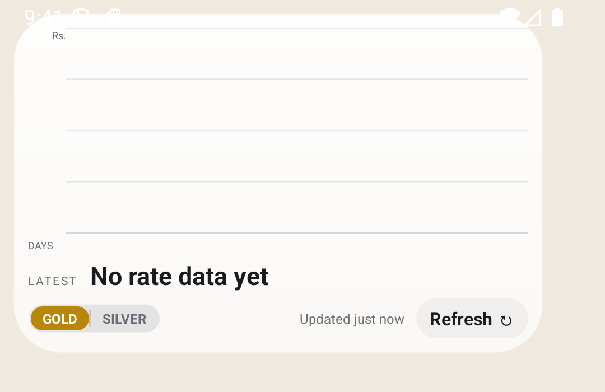
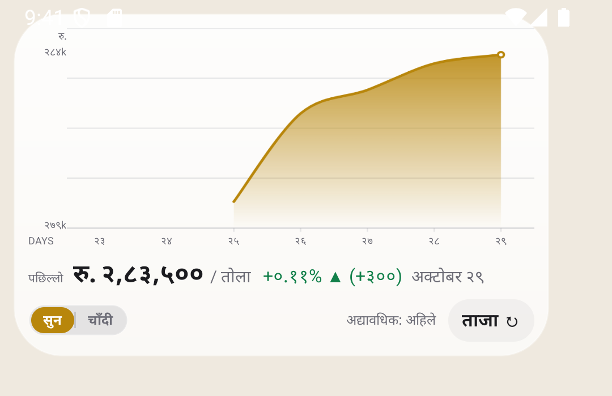
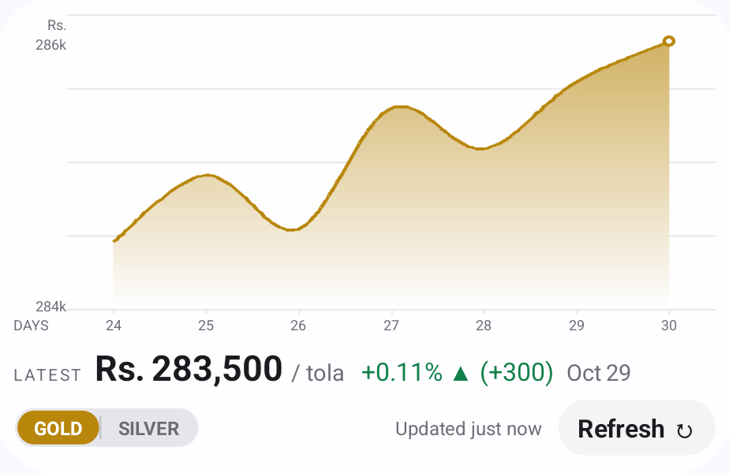

# Gold Rate — a home screen widget for the daily gold and silver rate

A small, widget-first Android app that shows the daily gold and silver rate published by
[fenegosida.org](https://fenegosida.org), straight on the home screen.

There is no launcher icon and no feed to scroll: you add the widget, and it shows the rate.

What changed in each version is in the [changelog](CHANGELOG.md).

| English | Nepali |
|---|---|
|  |  |

## What it does

- **A 4x2 home screen widget** with a chart of the last seven published days, the latest rate,
  the change against the previous day and the day the rate was published.
- **A GOLD / SILVER switch on the widget itself** — the chart, the accent colour and the amount
  follow it.
- **English and Nepali**, including Devanagari digits and the South Asian 2-2-3 grouping Nepal
  uses (`2,43,055`).
- **A daily background fetch** through WorkManager at 11:05 Nepal time — a little after the
  publisher publishes — plus a manual refresh button.
- **A notification when the publisher publishes a new rate** — the amount, the change and the day
  it belongs to, for the metal the widget is showing.
- **Thirty days of history**, kept on the device.
- **The history is filled in one go** on the first run: the publisher keeps a month of rates,
  and the app asks for it.
- **A hidden settings screen** (tap the widget) for the language, the metal, the transparency of
  the widget's surface and the history.



## The rate on the widget is the *latest*

The publisher updates once a day, in the late morning Nepal time. Before that, the endpoint
still serves the previous day's rates — so the widget says `LATEST` and prints the day the
rate belongs to (`Oct 29`, `अक्टोबर २९`) instead of pretending it is today's price.

## Data source

All rates come from the public API of fenegosida.org:

```
GET https://api.fenegosida.org/api/website/v1/Dashboard/today
GET https://api.fenegosida.org/api/website/v1/Dashboard/monthwisehistory?date=YYYY-MM
```

No account, no key, no tracking. The app stores the last 30 days locally and never sends
anything anywhere.

**This app is not affiliated with, endorsed by or supported by fenegosida.org.** It is an
unofficial client of their public endpoint. The rates belong to their publisher; check the
original source before acting on a number.

## Building

Requires JDK 17 or newer and the Android SDK (compile SDK 37).

```bash
./gradlew :app:assembleDebug        # debug APK
./gradlew :app:assembleRelease      # minified release APK
./gradlew :app:testDebugUnitTest    # JVM tests
./gradlew :app:connectedDebugAndroidTest   # instrumented tests, needs a device
```

Or open the project in Android Studio and run it.

- **minSdk** 26 (Android 8.0) · **targetSdk / compileSdk** 37
- Kotlin 2.2.10, AGP 9.4.1, Gradle 9.6.0
- No Compose and no networking library — the release APK is about 0.5 MB

## How it is put together

```
app/src/main/java/com/goldrate/widget/
├── data/      the API client, the parser, the store, the formatting
├── work/      the WorkManager scheduler and the daily sync worker
├── widget/    the widget provider, the RemoteViews renderer, the chart painter
├── ui/        the settings screen, the segmented control and the history table
└── notify/    the notification channel
```

A few decisions worth knowing about:

- **The chart is painted in the app** and handed to the launcher as a bitmap, because a
  RemoteViews widget cannot draw itself. Only the curve goes into that bitmap: a launcher
  reports the widget's *minimum* size rather than the size it really gave the widget, so the
  drawing is always stretched to fit, and text drawn into it would be stretched with it. Every
  label is a regular view instead.
- **The chart's x axis is a calendar.** A day the publisher did not publish keeps its place and
  carries no point, so a gap in the line is visible instead of hidden.
- **The daily fetch is timed in Nepal time.** A periodic WorkManager job has no time of day —
  Android runs it somewhere inside the 24-hour window — so the daily run is a one-off job with
  an initial delay, set for 11:05 Nepal time whatever the phone's timezone is. A six-hourly job
  runs beside it as a safety net, so a run the system deferred is still followed by a fetch.
- **The widget is built with the framework's `RemoteViews`.** That keeps the app free of a UI
  dependency and the release APK under 0.5 MB.
- **The app has no launcher activity.** The settings screen is opened by tapping the widget and
  is not exported.

## The icon

The launcher icon is original artwork generated for this project — it reproduces no existing
exchange's logo and carries no third-party trademark. See
[`app/ICON-SOURCE.md`](app/ICON-SOURCE.md) for the provenance and the usage rights.

